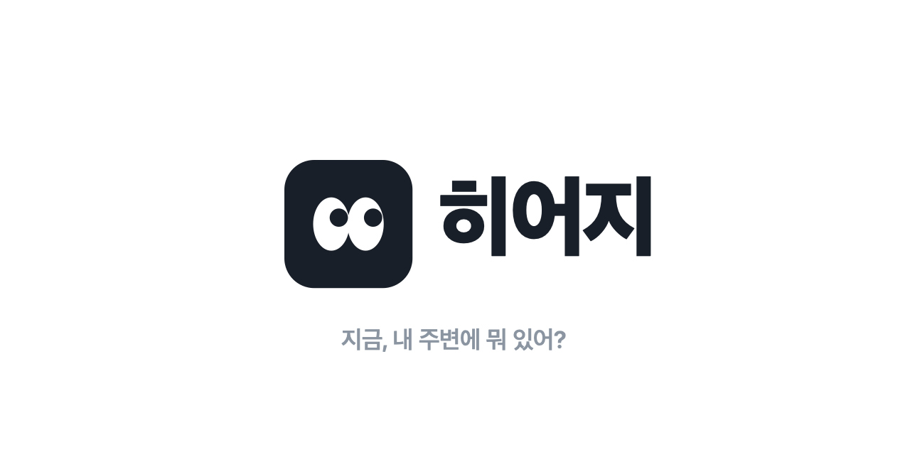

  

  앱을 열면, 위치만으로 <b>지금 내 주변에 뭐가 있는지</b> 보여줍니다. 
  벚꽃 개화부터 축제 · 공연 · 전시 · 팝업 · 야시장까지 — 오늘, 이번 주말에 갈 수 있는 모든 것.

---

### 저장소

| 저장소 | 설명 |
|---|---|
| [herezi-api](https://github.com/herezi/herezi-api) | Go API 서버 · 공공데이터 수집 · **제품 기획 문서의 기준** |
| [herezi-ios](https://github.com/herezi/herezi-ios) | iOS 앱 |
| [herezi-android](https://github.com/herezi/herezi-android) | Android 앱 |

### 진행 상황
- 📝 [서비스 기획서](https://github.com/herezi/herezi-api/blob/main/docs/product/SERVICE-PLAN.md) — 검토 중
- 🗺️ 서울부터 시작합니다

### 일하는 방식
에이전트 우선(harness engineering) 저장소로 운영합니다.
모든 작업은 **이슈 → 브랜치 → PR**로 진행하고, 기획은 승인 후 개발합니다.
